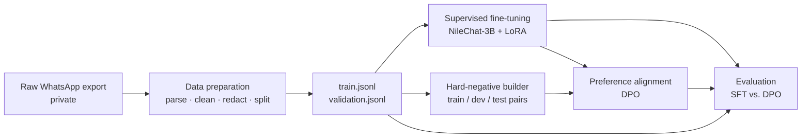

# WhatsApp Twin — fine-tuning a personal Egyptian-Arabic chat model

This folder is my own work on top of the [book's system](../README.md): a raw WhatsApp export becomes a 3B-parameter chat model that replies the way I do, in Egyptian Arabic. It covers data preparation, supervised fine-tuning (SFT), preference alignment (DPO), and a paired, significance-tested evaluation.

The *LLM Engineer's Handbook* builds its twin from public articles and code. I replaced that with a real private conversation, which changed almost every decision after data collection.

## Results

| Stage | What I built | Result |
|---|---|---|
| [Data preparation](data-preparation) | Parser, cleaner, PII redaction, session-level split, self-validation. Python standard library only | 135,289 raw lines → 26,989 multi-turn samples (24,915 train / 2,074 validation) from 874 sessions |
| [Supervised fine-tuning](supervised-fine-tuning) | LoRA fine-tuning of NileChat-3B on multi-turn chat data | Best validation loss 1.625, against 1.734 for Qwen2.5-3B. Stopped at checkpoint-1000, before overfitting |
| [Preference alignment](preference-alignment) | DPO with hard negatives mined from my own real replies, in a self-diagnosing notebook | Held-out preference accuracy 68.7% → 71.3% on 300 test pairs (paired McNemar, p ≈ 0.02–0.04) |
| [Evaluation](evaluation) | SFT vs. DPO on 150 unseen conversations: likelihood, automatic checks, and an LLM judge run in both A/B orders | Judge prefers DPO in 71% of decided pairs (p = 0.0003). DPO's median reply length is 29 characters against 48 for SFT; my real replies are 19.5 |

**One result goes the other way, and it is reported, not hidden:** DPO slightly lowers the likelihood of my exact words (perplexity 14.9 → 15.5, p < 0.0001). The two primary metrics disagree because they measure different things. The [evaluation write-up](evaluation#interpretation) explains why DPO is still the final model.

## Pipeline



Data preparation and the hard-negative builder run locally on CPU. Training and evaluation run on Google Colab (T4).

## Decisions that came from the data

Each of these came from reading real output, not from a plan made in advance.

- **AI-generated negatives made DPO useless.** The first DPO run reached 100% preference accuracy by step 36 of 180: the model only had to learn "avoid AI style". I rebuilt the dataset so that every rejected reply is a real reply of mine from a different conversation. The voice is the same and only the context is wrong. ([Preference alignment, Part 1](preference-alignment#part-1--the-hard-negative-dataset))
- **TF-IDF could not see ambiguous pairs.** Two replies about the same situation shared zero words and scored a similarity of 0.0000. Multilingual sentence embeddings replaced TF-IDF, and I confirmed the fix on the exact pairs that had been flagged.
- **The same pairs were choosing the checkpoint and reporting the result.** I split them into separate dev and test sets, so the reported number is never used for a training decision.
- **A wrong adapter was evaluated without any error.** An earlier evaluation silently loaded an outdated adapter. The notebook now verifies the adapter three ways before it generates anything.
- **A domain-matched base model beat a general one.** NileChat-3B, pretrained on Egyptian dialect, reached a lower validation loss than Qwen2.5-3B in about half the steps.
- **Splitting by sample would have leaked.** Sliding context windows overlap, so whole sessions are assigned to train or validation.
- **Names inside messages reached the model.** Only sender labels were anonymised: 24.1% of training samples contained a private name, and the v1 SFT loss counted every token, so the model learned to write them (23 of 150 evaluation replies, against 10 in my real ones). The builder now redacts listed names as whole words (`--redact-names-file`, 0 left), and [SFT v2](supervised-fine-tuning#version-2-notebookssft_nilechat_v2ipynb) trains on the final reply only. Retraining is the next step.

## Structure

```
whatsapp-twin/
├── data-preparation/           # raw WhatsApp export → validated train/validation files
│   ├── src/twin_dataset_builder.py
│   ├── scripts/                # one-command runner, post-build audit
│   ├── tests/                  # 11 unit tests, no dependencies
│   └── DATA_CONTRACT.md        # processing rules, output contract, privacy boundary
├── supervised-fine-tuning/     # LoRA fine-tuning (Colab notebook)
├── preference-alignment/       # hard-negative builder (script) + DPO training (Colab notebook)
├── evaluation/                 # evaluation notebook + CPU smoke tests for it
├── tools/                      # private-name scanner, notebook execution-order checker
└── zenml-ingestion-prototype/  # my first version of the data stage, in the book's ZenML style
```

Every folder has its own README with the design, the configuration, and the history of what failed and what fixed it.

## Run the tests

None of these need a GPU or the private data. Run them from the repository root.

```bash
# Data preparation: standard library only
python -m unittest discover -s whatsapp-twin/data-preparation/tests -v
```

```bash
# Every notebook is checked for names used before they are defined
python whatsapp-twin/tools/check_notebook_order.py whatsapp-twin/*/notebooks/*.ipynb
```

```bash
# Evaluation notebook: runs its real cells on CPU with a tiny model and a fake judge
pip install -r whatsapp-twin/evaluation/tests/requirements-test.txt
python whatsapp-twin/evaluation/tests/run_all.py
```

To build a dataset from your own WhatsApp export:

```bash
./whatsapp-twin/data-preparation/scripts/run_from_raw.sh /absolute/path/to/whatsapp_chat.txt
```

Training and evaluation are Colab notebooks. Each stage's README lists the steps.

## Privacy

The training data is a real private conversation, so this work is built around keeping it out of the repository.

- **No data, model, or generated output is committed.** The repository holds code, notebooks with outputs cleared, and aggregate results only. The data stays on my machine and on Google Drive.
- **Redaction at the source.** Contact names become `Contact`. Phone numbers, emails, URLs, and credential-like tokens become placeholders. This is privacy reduction, not a guarantee of anonymization, and [`DATA_CONTRACT.md`](data-preparation/DATA_CONTRACT.md) says so.
- **A scan before every push.** [`tools/check_private_names.py`](tools) scans files and notebook outputs for a private list of real names.
- **Anonymized judge input.** Listed names are replaced with `[NAME]` before any text is sent to the LLM judge's API.
- **Synthetic examples only.** The example messages in the code, tests, and documentation are made up, not taken from the conversation.

## Tech stack

Python · PyTorch · Hugging Face Transformers, PEFT, TRL, Datasets · Unsloth · LoRA · DPO · sentence-transformers · Google Colab (T4) · OpenAI-compatible judge API (Cerebras) · ZenML and Pydantic (prototype)

## Limitations

- The data is a single conversation. The results describe this data, not chat in general.
- The DPO gain in preference accuracy is likely real but small (+2.6 points).
- The evaluation uses one LLM judge, which was consistent under A/B swap on 77% of pairs. Inconsistent verdicts count as ties, never as wins.
- Replies on technical topics are comparatively weak, most likely because the conversation contains little of them.
- [`UBC-NLP/NileChat-3B`](https://huggingface.co/UBC-NLP/NileChat-3B) is licensed for **research only**, and that applies to any model derived from it.
